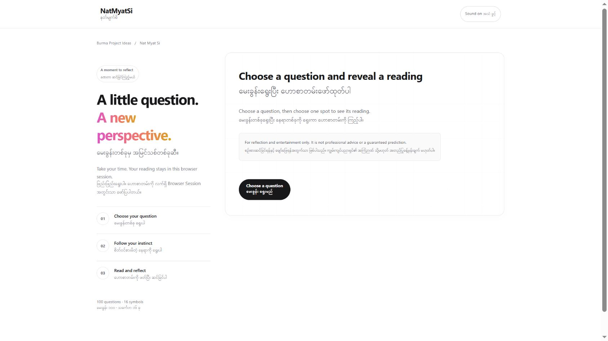

# Nat Myat Si (နတ်မျက်စိ)

[Burma Project Ideas](https://github.com/burma-project-ideas) အောက်မှာ နောက်လာမယ့်သူတွေ App Flow နဲ့ Data ကို လေ့လာပြီး ကိုယ်နှစ်သက်တဲ့ Programming Language နဲ့ ပြန်ရေးကြည့်နိုင်ဖို့ ထားပေးထားတဲ့ Project ပါ။ Organization ဆီ ပြောင်းရွှေ့ထားခြင်းက မူရင်း Creator နဲ့ Data Source Credit ကို အစားထိုးခြင်း မဟုတ်ပါဘူး။

[App ကို ဒီမှာ ဖွင့်နိုင်ပါတယ်](https://nat-myat-si.vercel.app/)။ Repository အမည်ပြောင်းပေမယ့် Live Domain ကို မပြောင်းထားပါဘူး။

NatMyatSi is a bilingual, client-only .NET 10 Blazor WebAssembly app. It runs entirely in the browser and is designed for static hosting on Vercel.

The app has no ASP.NET Core host, API endpoint, account, database, or submitted question. Its 100 questions, 16 symbols, and 1,600 readings are compiled directly into the WebAssembly application as C# static data.

## အသုံးပြုပုံ

1. မေးခွန်း ၁၀၀ ထဲက တစ်ခုကို ရွေးပါ သို့မဟုတ် ရှာပါ။
2. Shuffle လုပ်ထားတဲ့ 4 × 4 ကွက်ထဲက တစ်ကွက်ကို ရွေးပါ။
3. မေးခွန်းနဲ့ ရလာတဲ့ Symbol အတွဲရဲ့ အဖြေကို ဖတ်ပါ။
4. မေးခွန်းအသစ်ရွေးပါ သို့မဟုတ် လက်ရှိမေးခွန်းကို ပြန် Shuffle လုပ်ပါ။

## App ရဲ့ Workflow

`Pages/Home.razor.cs` က ရွေးထားတဲ့ Question နဲ့ Symbol State ကို ထိန်းပါတယ်။ `NatMyatSiDataService` က `Data/NatMyatSiStaticData.cs` ထဲမှာ Compile လုပ်ထားတဲ့ Catalog ကို ဖတ်ပြီး မေးခွန်း ၁၀၀၊ Symbol ၁၆ ခုနဲ့ အဖြေ ၁,၆၀၀ ပြည့်စုံမှု၊ Unique Pair ဖြစ်မှုကို စစ်ပါတယ်။ Question ရွေးပြီး Covered Grid ထဲက Position ကို နှိပ်တဲ့အခါ သက်ဆိုင်ရာ Symbol နဲ့ Answer ကို ရှာကာ `ReadingResult` Component မှာ ပြပါတယ်။ Runtime JSON Request နဲ့ Backend API မလိုပါဘူး။

## Project ဖွဲ့စည်းပုံ

| Path | တာဝန် |
| --- | --- |
| `Pages/Home.razor`, `Home.razor.cs` | Reading Flow နဲ့ UI State |
| `Components/` | Question Picker၊ Symbol Picker နဲ့ Result |
| `Data/NatMyatSiStaticData.cs` | Compiled Questions၊ Symbols နဲ့ Answers |
| `Models/` | Catalog Models နဲ့ Validation |
| `Services/` | Catalog Access နဲ့ Optional Sound Interop |
| `vercel.json`, `global.json` | Static Deployment နဲ့ Pinned SDK |

## Local မှာ Run မယ်

```powershell
dotnet run
```

Open the HTTPS address shown in the terminal.

## Compiled static data

The application builds its catalog from `Data/NatMyatSiStaticData.cs`. It does not request a JSON file or call an API at runtime. The compiled catalog is validated before the reading flow starts:

- exactly 100 unique questions;
- exactly 16 unique symbols;
- one unique answer for every question-and-symbol pair.

## Build နဲ့ Deployment

`vercel.json` installs the pinned .NET 10 SDK, publishes the standalone WebAssembly project, serves `dist/wwwroot`, and provides a single-page-app route fallback.

Import the repository into Vercel with the project root unchanged. No framework preset, serverless function, or environment variable is required.

## Accessibility and design

The interface uses native controls, concise bilingual English and Myanmar copy, visible keyboard focus, 44-pixel minimum targets, responsive reflow, and reduced-motion support. Its clean card-based interface keeps the covered-position grid and optional synthesized interface sounds that are off by default. The font stack uses San Francisco on Apple platforms and Segoe UI on Windows, with system fallbacks for Myanmar glyphs.

## စစ်ဆေးမယ်

`dotnet build -c Release` နဲ့ Build စစ်ပါ။ Question Search၊ Shuffle၊ Symbol Reveal၊ Question ပြောင်းခြင်းနဲ့ Keyboard Navigation ကို စမ်းပါ။ မေးခွန်းနဲ့ အဖြေတွေက ရိုးရာအကြောင်းအရာဖြစ်ပြီး အတည်ပြုထားတဲ့ ခန့်မှန်းချက်များ မဟုတ်ပါဘူး။


## အဓိက ပံ့ပိုးသူများနှင့် မူရင်း Data

App implementation: [Sann Lynn Htun](https://github.com/sannlynnhtun-coding)။ ရိုးရာမေးခွန်း/အဖြေ Data ရဲ့ မူရင်းစာအုပ်နဲ့ စာရေးသူကို Repository မှာ မသတ်မှတ်ထားသေးပါဘူး။ Padauk Font Notice ကို `wwwroot/fonts/OFL-Padauk.txt` မှာ ဖတ်နိုင်ပါတယ်။

## ကိုယ်တိုင် ပြန်ရေးကြည့်ချင်ရင်

အပေါ်က App Workflow ကို အဆင့်လိုက် လေ့လာပြီး UI၊ Data နဲ့ State ကို ခွဲရေးကြည့်နိုင်ပါတယ်။ Bug Report၊ Documentation နဲ့ Implementation အသစ်တွေကို Issue / Pull Request နဲ့ ပံ့ပိုးနိုင်ပါတယ်။ မူရင်းပံ့ပိုးသူနဲ့ Data Credit ကို ဆက်လက်ထိန်းသိမ်းပါ။

## UI Design Update

The current interface follows [PrebuiltUI](https://prebuiltui.com/)'s visual direction: spacious white surfaces, subtle grid backgrounds, gradient headings, rounded cards, and pill controls. These patterns are implemented with CSS and native Blazor components; no React migration or new UI dependency is required. The earlier shared Blazor foundation remains in place.

The redesign preserves application data, calculations, and browser storage keys. Responsive layouts and visible keyboard focus remain available. Myanmar text uses the self-hosted Padauk font; its license is retained in `wwwroot/fonts/OFL-Padauk.txt`.



[Mobile preview](screenshots/redesign-mobile.jpg)
